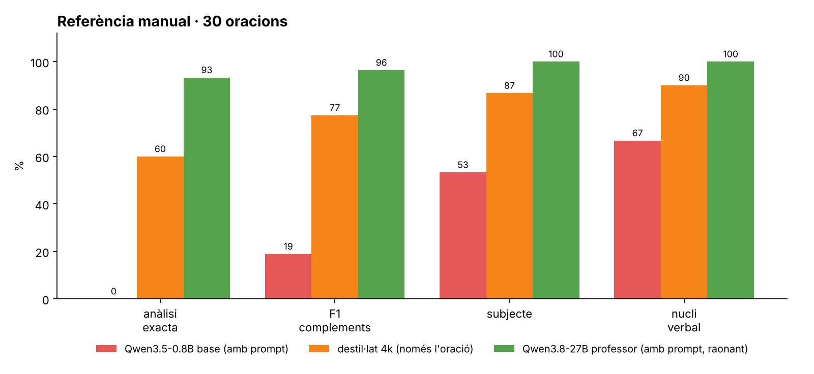

# Destil·lació: d'un Qwen gran a un Qwen petit

Demo per a una xerrada sobre models petits: un **analitzador sintàctic del català** (oració simple → JSON amb subjecte, nucli verbal, CD, CI, atribut, CPRED, CRV, CAG, CC…) destil·lat d'un Qwen gran a un de molt petit, tot a Google Colab.

## Flux

1. **El petit sense entrenar** (Qwen3.5-0.8B) sobre 30 oracions anotades a mà → no se'n surt.
2. **El professor** (Qwen3.8-27B) escriu ~4.000 oracions amb una estructura sintàctica demanada i després les analitza *a cegues*.
3. **Filtre**: validació determinista (fragments literals, sense solapaments, coherència nominal⇔atribut, CAG⇔passiva…) + coincidència entre l'anàlisi a cegues i l'estructura demanada.
4. **Destil·lació**: SFT complet de l'alumne amb les anàlisis filtrades (sense raonament).
5. **Avaluació**: petit base vs destil·lat vs professor, sobre la referència manual i un test de 300 oracions.

## A Hugging Face

| | 4k (3.964 oracions generades → 975 d'entrenament) | 10k |
|---|---|---|
| dataset | [xaviviro/sintaxi-catala-destillada-4k](https://huggingface.co/datasets/xaviviro/sintaxi-catala-destillada-4k) | [xaviviro/sintaxi-catala-destillada-10k](https://huggingface.co/datasets/xaviviro/sintaxi-catala-destillada-10k) *(en preparació)* |
| model | [xaviviro/Qwen3.5-0.8B-sintaxi-catala-4k](https://huggingface.co/xaviviro/Qwen3.5-0.8B-sintaxi-catala-4k) | [xaviviro/Qwen3.5-0.8B-sintaxi-catala-10k](https://huggingface.co/xaviviro/Qwen3.5-0.8B-sintaxi-catala-10k) *(en preparació)* |

## Fitxers

| fitxer | què fa |
|---|---|
| `destillacio_sintaxi_catala.ipynb` | el notebook de Colab, en format «presentació» (títols numerats, codi amagat en formularis) |
| `common.py` | prompt, validació, mètriques, visualització i les 30 oracions de referència |
| `infer.py` | inferència per lots amb vLLM (en un procés a part, per alliberar la GPU) |
| `gen_frases.py` | el professor genera oracions amb estructura demanada |
| `build.py` | regenera el notebook a partir dels `.py` |
| `publicar_hf.py` | genera les fitxes (en català, amb gràfics i exemples) i publica datasets i models a Hugging Face |

Les dades i el model es desen a Google Drive (`MyDrive/destillacio_sintaxi`) i es reutilitzen si ja hi són.

## Resultats (mesurats, model 4k)

**Referència manual — 30 oracions anotades a mà**

| model | anàlisi exacta | F1 complements | subjecte | nucli verbal | tokens de prompt | ms/frase* |
|---|---|---|---|---|---|---|
| Qwen3.5-0.8B base (amb prompt) | 0,0 % | 18,9 % | 53,3 % | 66,7 % | 579 | 21 |
| **destil·lat 4k (només l'oració)** | **60,0 %** | **77,4 %** | **86,7 %** | **90,0 %** | **23** | **11** |
| Qwen3.8-27B professor (amb prompt, raonant) | 93,3 % | 96,4 % | 100 % | 100 % | 615 | 1.712 |

**Test — 300 oracions (etiquetes del professor)**: anàlisi exacta 0,3 % (base) → **86,7 %** (destil·lat 4k); F1 complements 10,1 % → **92,4 %**.

\* Temps mitjà per oració en lot amb vLLM (RTX PRO 6000, 96 GB); no és latència d'una crida aïllada.

**Verbs incoatius** (10 oracions fora del dataset): base amb prompt 1/10; base només amb l'oració 0/10 (no torna JSON); destil·lat 4k 7/10 (+1 discutible). Errors: CPRED confós amb CD, i alguna forma verbal mal copiada («obeeixen» → «oboeyen»).

**Filtre**: de 3.964 anàlisis del professor en passen 1.275 (32 %); la majoria de descarts (2.422) són perquè l'anàlisi a cegues no coincideix amb l'estructura demanada.

## Advertiments

- La referència manual (30 oracions) està anotada a mà seguint la gramàtica escolar i **encara no s'ha revisat**: es pot corregir a `common.py`.
- Al test de 300 oracions les etiquetes són del professor (filtrades): mesura com imita el professor, no la correcció absoluta.
