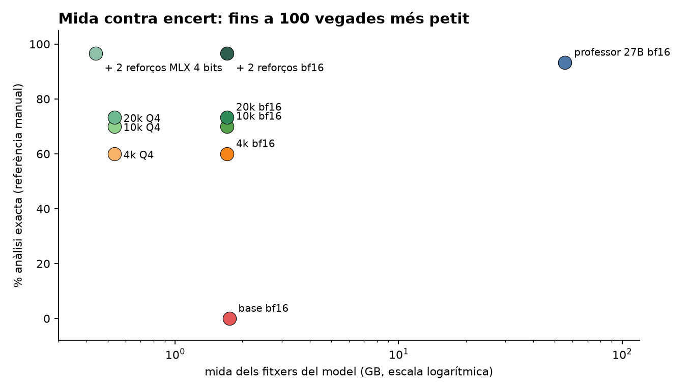
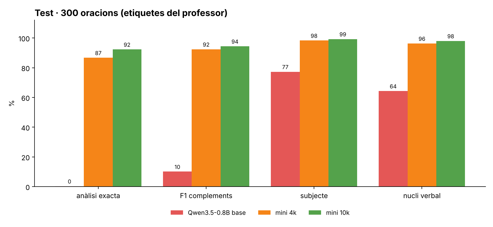
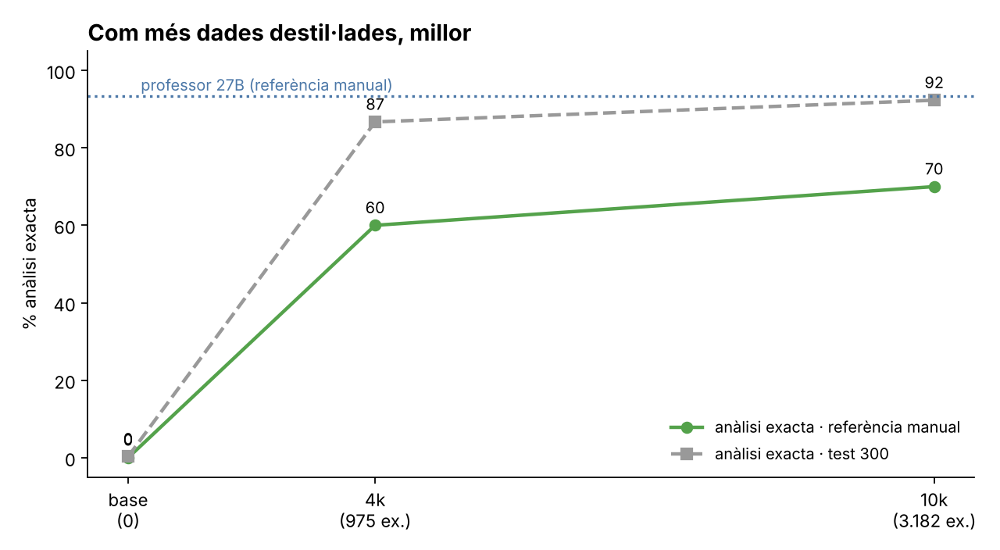
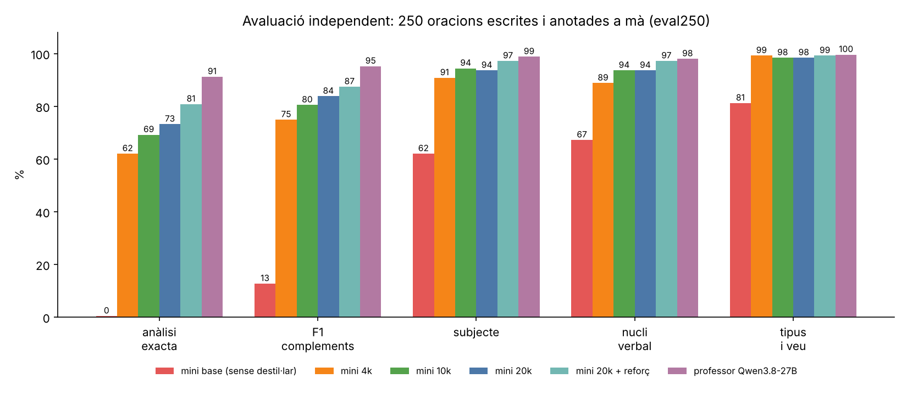
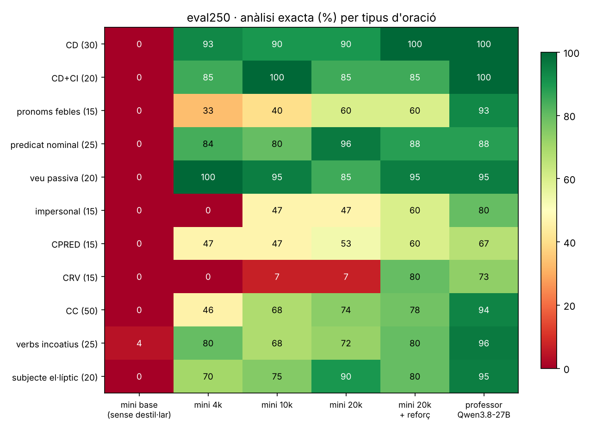
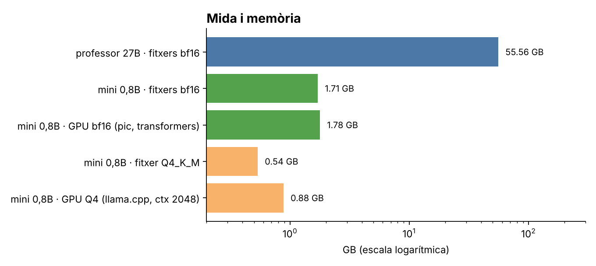

# Destil·lació: d'un Qwen gran a un Qwen petit

Demo per a una xerrada sobre models petits: un **analitzador sintàctic del català** que, donada **només una oració**, respon amb la seva anàlisi escolar en JSON (subjecte, nucli verbal, CD, CI, atribut, CPRED, CRV, CAG, CC…). Destil·lat d'un **Qwen3.8-27B** (professor) a un **Qwen3.5-0.8B** (alumne), tot a Google Colab.

```text
Entrada:  L'àvia serveix la sopa als néts.
Sortida:  {"subjecte": {"text": "L'àvia", "nucli": "àvia", "eliptic": false},
           "predicat": {"tipus": "verbal", "nucli": "serveix",
                        "complements": [{"funcio": "CD", "text": "la sopa"}, {"funcio": "CI", "text": "als néts"}]},
           "veu": "activa", "impersonal": false}
```

## En una imatge



El mini destil·lat amb 20k oracions encerta l'anàlisi exacta en el **73 %** de la referència manual, ocupant **0,53 GB en Q4** (el professor, 55,6 GB, en fa el 93 %). Sense destil·lar, el mateix mini en fa el **0 %**.

## Models i datasets (Hugging Face)

| | 4k | 10k | 20k |
|---|---|---|---|
| oracions generades → filtrades → train | 3.964 → 1.275 → 975 | 10.421 → 3.485 → 3.182 | 20.512 → 6.953 → 6.649 |
| dataset | [sintaxi-catala-destillada-4k](https://huggingface.co/datasets/xaviviro/sintaxi-catala-destillada-4k) | [sintaxi-catala-destillada-10k](https://huggingface.co/datasets/xaviviro/sintaxi-catala-destillada-10k) | [sintaxi-catala-destillada-20k](https://huggingface.co/datasets/xaviviro/sintaxi-catala-destillada-20k) |
| model bf16 (1,7 GB) | [Qwen3.5-0.8B-sintaxi-catala-4k](https://huggingface.co/xaviviro/Qwen3.5-0.8B-sintaxi-catala-4k) | [Qwen3.5-0.8B-sintaxi-catala-10k](https://huggingface.co/xaviviro/Qwen3.5-0.8B-sintaxi-catala-10k) | [Qwen3.5-0.8B-sintaxi-catala-20k](https://huggingface.co/xaviviro/Qwen3.5-0.8B-sintaxi-catala-20k) |
| GGUF Q4_K_M (0,53 GB, LM Studio) | […-4k-GGUF](https://huggingface.co/xaviviro/Qwen3.5-0.8B-sintaxi-catala-4k-GGUF) | […-10k-GGUF](https://huggingface.co/xaviviro/Qwen3.5-0.8B-sintaxi-catala-10k-GGUF) | […-20k-GGUF](https://huggingface.co/xaviviro/Qwen3.5-0.8B-sintaxi-catala-20k-GGUF) |
| test independent (250 a mà) | [sintaxi-catala-eval250](https://huggingface.co/datasets/xaviviro/sintaxi-catala-eval250) · per a les tres mides | | |

**20k + reforç** (el millor mini, vegeu «Segona ronda» més avall): [dataset](https://huggingface.co/datasets/xaviviro/sintaxi-catala-destillada-20k-reforc) · [model bf16](https://huggingface.co/xaviviro/Qwen3.5-0.8B-sintaxi-catala-20k-reforc) · [GGUF Q4_K_M per a LM Studio](https://huggingface.co/xaviviro/Qwen3.5-0.8B-sintaxi-catala-20k-reforc-GGUF).

## Comparativa d'efectivitat (mesurada)

**Referència manual — 30 oracions anotades a mà**


| model | entrada | anàlisi exacta | F1 complements | F1 funcions | subjecte | nucli verbal | sortida vàlida |
|---|---|---|---|---|---|---|---|
| Qwen3.5-0.8B base | prompt complet (~580 tokens) | 0,0 % | 18,9 % | 27,4 % | 53,3 % | 66,7 % | 53,3 % |
| mini 4k | només l'oració (~23 tokens) | 60,0 % | 77,4 % | 83,0 % | 86,7 % | 90,0 % | 96,7 % |
| mini 4k · Q4_K_M | només l'oració | 60,0 % | 78,1 % | 83,8 % | 86,7 % | 90,0 % | 93,3 % |
| mini 10k | només l'oració | 70,0 % | 80,7 % | 86,2 % | 93,3 % | 90,0 % | 96,7 % |
| mini 10k · Q4_K_M | només l'oració | 70,0 % | 80,7 % | 86,2 % | 93,3 % | 90,0 % | 96,7 % |
| **mini 20k** | només l'oració | **73,3 %** | **85,5 %** | **87,3 %** | **90,0 %** | **96,7 %** | **100 %** |
| mini 20k · Q4_K_M | només l'oració | 73,3 % | 85,5 % | 87,3 % | 90,0 % | 96,7 % | 100 % |
| Qwen3.8-27B (professor) | prompt complet + raonament | 93,3 % | 96,4 % | 96,4 % | 100 % | 100 % | 100 % |

Al 10k i al 20k, les 30 anàlisis del Q4 són **idèntiques** a les del bf16; al 4k ho són 27 de 30 (90 %).

**Test — 300 oracions (etiquetes del professor, filtrades; el mateix test per a totes les mides)**



| model | anàlisi exacta | F1 complements | subjecte | nucli verbal |
|---|---|---|---|---|
| Qwen3.5-0.8B base | 0,3 % | 10,1 % | 77,3 % | 64,3 % |
| mini 4k | 86,7 % | 92,4 % | 98,3 % | 96,3 % |
| mini 10k | 92,3 % | 94,4 % | 99,3 % | 98,0 % |
| mini 20k | 92,3 % | 95,4 % | 99,0 % | 99,3 % |

⚠️ Aquest test mesura **com imita el professor**, no la correcció absoluta. La xifra de qualitat és la de la referència manual.

**Corba de dades** — de 4k a 10k l'anàlisi exacta guanya 10 punts; de 10k a 20k, 3 (i el test no es mou): rendiments decreixents.



**Verbs incoatius** (10 oracions fora del dataset, avaluades a mà):

| | correctes |
|---|---|
| base, prompt complet | 1 / 10 |
| base, només l'oració | 0 / 10 (no retorna JSON) |
| mini 4k (bf16 i Q4) | 7 / 10 |
| mini 10k (bf16 i Q4) | 9 / 10 |
| mini 20k (bf16 i Q4) | 8 / 10 (+1 discutible) |

El 10k ja encerta el complement predicatiu («Els avis envelleixen *tranquils* al poble», que el 4k marcava com a CD) i separa «un pont nou» (CD) de «sobre el riu» (CC de lloc). Cap mini copia bé «obeeixen» (4k «oboeyen», 10k «oboeixen», 20k «obeixen»). El 20k torna a posar «un pont nou sobre el riu» sencer com a CD (defensable com a complement del nom). Amb 10 oracions, la diferència 10k/20k és soroll.

## Avaluació independent — eval250 (mesurada)

La referència manual (30) és petita i el test de 300 té etiquetes del professor. Per això hi ha un tercer test: **250 oracions noves, escrites i anotades a mà**,
separades de tot el procés de destil·lació. Cap no l'ha generada el professor i, comprovat, cap no coincideix amb les ~20.500 oracions generades.
Cobreix 11 tipus d'oració. Dataset: [xaviviro/sintaxi-catala-eval250](https://huggingface.co/datasets/xaviviro/sintaxi-catala-eval250) (`eval250.py`, `resultats/eval250.jsonl`).



| model | anàlisi exacta | F1 complements | F1 funcions | subjecte | nucli verbal | tipus i veu | JSON vàlid | ms/oració |
|---|---|---|---|---|---|---|---|---|
| mini base (sense destil·lar) | **0.4** | 12.7 | 20.6 | 62.0 | 67.2 | 81.2 | 100.0 | 8.8 |
| mini 4k | **62.0** | 74.9 | 80.2 | 90.8 | 88.8 | 99.2 | 100.0 | 3.9 |
| mini 10k | **69.2** | 80.5 | 84.1 | 94.4 | 93.6 | 98.4 | 100.0 | 4.0 |
| mini 20k | **73.2** | 83.8 | 86.2 | 93.6 | 93.6 | 98.4 | 99.6 | 4.0 |
| mini 20k + reforç | **80.8** | 87.4 | 90.1 | 97.2 | 97.2 | 99.2 | 100.0 | 3.9 |
| professor Qwen3.8-27B | **91.2** | 95.2 | 95.5 | 98.8 | 98.0 | 99.6 | 99.6 | 881.1 |



Anàlisi exacta (%) per tipus d'oració:

| tipus d'oració (n) | mini base (sense destil·lar) | mini 4k | mini 10k | mini 20k | mini 20k + reforç | professor Qwen3.8-27B |
|---|---|---|---|---|---|---|
| CD (30) | 0 | 93 | 90 | 90 | 100 | 100 |
| CD+CI (20) | 0 | 85 | 100 | 85 | 85 | 100 |
| pronoms febles (15) | 0 | 33 | 40 | 60 | 60 | 93 |
| predicat nominal (25) | 0 | 84 | 80 | 96 | 88 | 88 |
| veu passiva (20) | 0 | 100 | 95 | 85 | 95 | 95 |
| impersonal (15) | 0 | 0 | 47 | 47 | 60 | 80 |
| CPRED (15) | 0 | 47 | 47 | 53 | 60 | 67 |
| CRV (15) | 0 | 0 | 7 | 7 | 80 | 73 |
| CC (50) | 0 | 46 | 68 | 74 | 78 | 94 |
| verbs incoatius (25) | 4 | 80 | 68 | 72 | 80 | 96 |
| subjecte el·líptic (20) | 0 | 70 | 75 | 90 | 80 | 95 |

Què s'hi veu (mesurat):
- Mateixa ordenació que a la referència manual: base 0,4 % → 4k 62 % → 10k 69 % → 20k 73 % → (20k + reforç 81 %) → professor 91 %. Els resultats de la referència de 30 (60 / 70 / 73 / 93) es mantenen amb un test 8 vegades més gran.
- **CRV**: el mini falla gairebé sempre (0–7 %). El confon amb un CC de lloc («pensa *en el seu avi*» → CC_LLOC). El professor l'encerta en el 73 %. Al train de 20k només hi ha 8 CRV.
- **Impersonals** (47 % al 10k i al 20k, 0 % al 4k) i **pronoms febles** (33 → 60 %) són els altres punts febles; el professor hi arriba al 80 % i al 93 %.
- CD, CD+CI, passiva i predicat nominal: ≥ 85 % al 20k.

### Segona ronda: reforç dirigit als punts febles (mesurat)

Per comprovar si el que faltava eren exemples dels grups febles, el professor va escriure 4.757 oracions noves centrades en CRV (35 %), impersonals (25 %),
pronoms febles (30 %) i CPRED (10 %), amb una pista sobre què és un CRV. Les va analitzar a cegues i va passar el mateix filtre: en van quedar **1.033**,
340 amb CRV (al 20k n'hi havia 8). Es va tornar a entrenar el mini des del model base amb el 20k + reforç (7.682 exemples) i la mateixa configuració.

| | eval250 | CRV | impersonals | pronoms febles | referència manual (30) | test (300) |
|---|---|---|---|---|---|---|
| mini 20k | 73,2 | 6,7 | 46,7 | 60,0 | 73,3 | 92,3 |
| **mini 20k + reforç** | **80,8** | **80,0** | 60,0 | 60,0 | **83,3** | 93,0 |

- El CRV passa de 7 a 80 %: amb exemples, el model petit l'aprèn.
- També millora la referència manual de 30, que no es va fer servir per decidir el reforç.
- Els pronoms febles no milloren (60 %), i el predicat nominal i el subjecte el·líptic baixen 2 oracions cadascun.
- Avís: el reforç es va dirigir als grups on fallava l'eval250. Cap oració de l'eval250 no s'ha fet servir, però en aquests grups l'eval250 ja no és una mesura del tot independent.

Model: [Qwen3.5-0.8B-sintaxi-catala-20k-reforc](https://huggingface.co/xaviviro/Qwen3.5-0.8B-sintaxi-catala-20k-reforc) ·
GGUF: [...-20k-reforc-GGUF](https://huggingface.co/xaviviro/Qwen3.5-0.8B-sintaxi-catala-20k-reforc-GGUF) ·
dataset: [sintaxi-catala-destillada-20k-reforc](https://huggingface.co/datasets/xaviviro/sintaxi-catala-destillada-20k-reforc).
Codi: `gen_frases.py --reforc 1`, `reforc.py`, `reforc_train_cell.py`, `publica_reforc.py`.

## Mides, memòria i cost



| | paràmetres | fitxers | memòria |
|---|---|---|---|
| Qwen3.8-27B (professor) | 27,8 B | 55,6 GB (bf16) | ≥ 55,6 GB de GPU només per als pesos (no mesurat en execució: vLLM reserva tota la GPU que se li dona) |
| Qwen3.5-0.8B (base i minis) | 0,85–0,87 B | 1,7 GB (bf16) | **1,78 GB** de GPU de pic (transformers, una oració; sense el context CUDA) |
| mini Q4_K_M (GGUF) | — | **0,53 GB** | **~0,88 GB** de GPU (llama.cpp, context de 2.048 tokens, inclou el context CUDA) |


- **Tokens d'entrada per oració**: ~580 (base i professor, amb instruccions i exemple) → **~23** (mini destil·lat, només l'oració): **−96 %**.
- **Temps per oració** (lot de 30 amb vLLM, RTX PRO 6000): professor 1.712 ms (raona) · base 21 ms · mini 11 ms. Q4 amb llama.cpp, d'una en una: ~0,42 s a una L4 i ~0,15 s a una RTX PRO 6000.
- **Cost de fer el dataset**: el professor analitza cada oració en ~0,68 s (~750 tokens de raonament + resposta, ~1.100 tokens/s). 20.512 oracions ≈ 4 h de GPU.

**No mesurat**: memòria i velocitat a Mac (LM Studio). Les xifres són de GPUs NVIDIA a Colab.

## Com s'ha fet

1. **El petit sense entrenar** (Qwen3.5-0.8B) sobre les 30 oracions de referència → 0 % d'anàlisis exactes.
2. **El professor** (Qwen3.8-27B, vLLM) escriu oracions amb una **estructura sintàctica demanada** (tipus de subjecte, de predicat, veu i complements) sobre 40 temes, i després les analitza **a cegues**, raonant.
3. **Filtre**: validació determinista (fragments literals, sense solapaments, nominal ⇔ atribut, CAG ⇒ passiva…) **i** coincidència entre l'anàlisi a cegues i l'estructura demanada. En passa un **32–33 %**; el gros del descart és que l'anàlisi no coincideix amb l'estructura que s'havia demanat.
4. **Destil·lació**: fine-tuning complet de l'alumne (TRL `SFTTrainer`, 3 èpoques, lr 2e-5), **sense prompt**: només l'oració → el JSON. El raonament del professor no s'hi inclou.
5. **Avaluació**: referència manual (30) i test fix (300). **Quantització**: GGUF Q4_K_M amb llama.cpp i plantilla de xat que desactiva sempre el raonament.

## Fitxers

| fitxer | què fa |
|---|---|
| `destillacio_sintaxi_catala.ipynb` | el notebook de Colab, en format «presentació» (títols numerats, codi amagat en formularis) |
| `common.py` | prompt, validació, mètriques, visualització i les 30 oracions de referència |
| `infer.py` | inferència per lots amb vLLM (en un procés a part, per alliberar la GPU) |
| `gen_frases.py` | el professor genera oracions amb estructura demanada |
| `build.py` | regenera el notebook a partir dels `.py` |
| `publicar_hf.py` | fitxes en català (amb gràfics i exemples) i publicació de datasets i models a Hugging Face |
| `gguf_q4.py` | conversió a GGUF Q4_K_M, validació contra el bf16 i publicació |
| `eval250.py` · `eval250_analisi.py` · `actualitza_cards.py` | les 250 oracions de test, les mètriques i gràfics per tipus d'oració, i l'actualització de les fitxes de HF |
| `grafics_readme.py` + `resultats/resultats.json` | les gràfiques d'aquest README, a partir de les xifres mesurades |

Les dades i els models es desen a Google Drive (`MyDrive/destillacio_sintaxi`) i es reutilitzen si ja hi són; l'ampliació del dataset va per lots (`OBJECTIU_FRASES`).

## Advertiments

- La referència manual (30 oracions) i l'eval250 estan anotades a mà seguint la gramàtica escolar i **encara no s'han revisat externament**: es poden corregir a `common.py` i `eval250.py`. Amb 30 oracions, cada oració és un 3,3 %.
- Els datasets són **sintètics**: el filtre comprova l'estructura, no la qualitat lingüística (hi queden castellanismes i oracions poc naturals).
- Funcions poc representades (CRV, CC de quantitat): pocs exemples fins i tot al 20k (8 i 19).

## Llicència

Codi: Apache 2.0. Datasets: CC BY 4.0. Models: Apache 2.0 (com el model base).
Autor: Xavier Vinaixa Roselló ([xaviviro](https://huggingface.co/xaviviro)), Sorensen AI, Barcelona, Catalunya.

## Citació

```bibtex
@misc{vinaixa2026destillaciosintaxi,
  title        = {Destil·lació d'un analitzador sintàctic del català: de Qwen3.8-27B a Qwen3.5-0.8B},
  author       = {Vinaixa Roselló, Xavier},
  year         = {2026},
  institution  = {Sorensen AI, Barcelona},
  note         = {ORCID: 0009-0005-2769-9215},
  doi          = {Pendent},
  url          = {Pendent}
}
```
