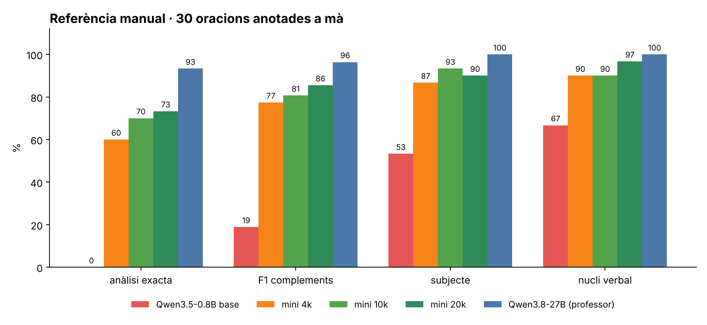
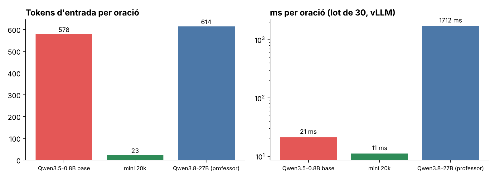

# Destil·lació: d'un Qwen gran a un Qwen petit

Demo per a una xerrada sobre models petits: un **analitzador sintàctic del català** que, donada **només una oració**, respon amb la seva anàlisi escolar en JSON (subjecte, nucli verbal, CD, CI, atribut, CPRED, CRV, CAG, CC…). Destil·lat d'un **Qwen3.8-27B** (professor) a un **Qwen3.5-0.8B** (alumne), tot a Google Colab.

```text
Entrada:  L'àvia serveix la sopa als néts.
Sortida:  {"subjecte": {"text": "L'àvia", "nucli": "àvia", "eliptic": false},
           "predicat": {"tipus": "verbal", "nucli": "serveix",
                        "complements": [{"funcio": "CD", "text": "la sopa"}, {"funcio": "CI", "text": "als néts"}]},
           "veu": "activa", "impersonal": false}
```

## En una imatge


El mini destil·lat amb 20k oracions encerta l'anàlisi exacta en el **73 %** de la referència manual, ocupant **0,53 GB en Q4** (el professor, 55,6 GB, en fa el 93 %). Sense destil·lar, el mateix mini en fa el **0 %**.

## Models i datasets (Hugging Face)

| | 4k | 10k | 20k |
|---|---|---|---|
| oracions generades → filtrades → train | 3.964 → 1.275 → 975 | 10.421 → 3.485 → 3.182 | 20.512 → 6.953 → 6.649 |
| dataset | [sintaxi-catala-destillada-4k](https://huggingface.co/datasets/xaviviro/sintaxi-catala-destillada-4k) | [sintaxi-catala-destillada-10k](https://huggingface.co/datasets/xaviviro/sintaxi-catala-destillada-10k) | [sintaxi-catala-destillada-20k](https://huggingface.co/datasets/xaviviro/sintaxi-catala-destillada-20k) |
| model bf16 (1,7 GB) | [Qwen3.5-0.8B-sintaxi-catala-4k](https://huggingface.co/xaviviro/Qwen3.5-0.8B-sintaxi-catala-4k) | [Qwen3.5-0.8B-sintaxi-catala-10k](https://huggingface.co/xaviviro/Qwen3.5-0.8B-sintaxi-catala-10k) | [Qwen3.5-0.8B-sintaxi-catala-20k](https://huggingface.co/xaviviro/Qwen3.5-0.8B-sintaxi-catala-20k) |
| GGUF Q4_K_M (0,53 GB, LM Studio) | […-4k-GGUF](https://huggingface.co/xaviviro/Qwen3.5-0.8B-sintaxi-catala-4k-GGUF) | […-10k-GGUF](https://huggingface.co/xaviviro/Qwen3.5-0.8B-sintaxi-catala-10k-GGUF) | […-20k-GGUF](https://huggingface.co/xaviviro/Qwen3.5-0.8B-sintaxi-catala-20k-GGUF) |

## Comparativa d'efectivitat (mesurada)

**Referència manual — 30 oracions anotades a mà**



| model | entrada | anàlisi exacta | F1 complements | F1 funcions | subjecte | nucli verbal | sortida vàlida |
|---|---|---|---|---|---|---|---|
| Qwen3.5-0.8B base | prompt complet (~580 tokens) | 0,0 % | 18,9 % | 27,4 % | 53,3 % | 66,7 % | 53,3 % |
| mini 4k | només l'oració (~23 tokens) | 60,0 % | 77,4 % | 83,0 % | 86,7 % | 90,0 % | 96,7 % |
| mini 4k · Q4_K_M | només l'oració | 60,0 % | 78,1 % | 83,8 % | 86,7 % | 90,0 % | 93,3 % |
| mini 10k | només l'oració | 70,0 % | 80,7 % | 86,2 % | 93,3 % | 90,0 % | 96,7 % |
| mini 10k · Q4_K_M | només l'oració | 70,0 % | 80,7 % | 86,2 % | 93,3 % | 90,0 % | 96,7 % |
| **mini 20k** | només l'oració | **73,3 %** | **85,5 %** | **87,3 %** | **90,0 %** | **96,7 %** | **100 %** |
| mini 20k · Q4_K_M | només l'oració | 73,3 % | 85,5 % | 87,3 % | 90,0 % | 96,7 % | 100 % |
| Qwen3.8-27B (professor) | prompt complet + raonament | 93,3 % | 96,4 % | 96,4 % | 100 % | 100 % | 100 % |

Al 10k i al 20k, les 30 anàlisis del Q4 són **idèntiques** a les del bf16; al 4k ho són 27 de 30 (90 %).

**Test — 300 oracions (etiquetes del professor, filtrades; el mateix test per a totes les mides)**


| model | anàlisi exacta | F1 complements | subjecte | nucli verbal |
|---|---|---|---|---|
| Qwen3.5-0.8B base | 0,3 % | 10,1 % | 77,3 % | 64,3 % |
| mini 4k | 86,7 % | 92,4 % | 98,3 % | 96,3 % |
| mini 10k | 92,3 % | 94,4 % | 99,3 % | 98,0 % |
| mini 20k | 92,3 % | 95,4 % | 99,0 % | 99,3 % |

⚠️ Aquest test mesura **com imita el professor**, no la correcció absoluta. La xifra de qualitat és la de la referència manual.

**Corba de dades** — de 4k a 10k l'anàlisi exacta guanya 10 punts; de 10k a 20k, 3 (i el test no es mou): rendiments decreixents.


**Verbs incoatius** (10 oracions fora del dataset, avaluades a mà):

| | correctes |
|---|---|
| base, prompt complet | 1 / 10 |
| base, només l'oració | 0 / 10 (no retorna JSON) |
| mini 4k (bf16 i Q4) | 7 / 10 |
| mini 10k (bf16 i Q4) | 9 / 10 |
| mini 20k (bf16 i Q4) | 8 / 10 (+1 discutible) |

El 10k ja encerta el complement predicatiu («Els avis envelleixen *tranquils* al poble», que el 4k marcava com a CD) i separa «un pont nou» (CD) de «sobre el riu» (CC de lloc). Cap mini copia bé «obeeixen» (4k «oboeyen», 10k «oboeixen», 20k «obeixen»). El 20k torna a posar «un pont nou sobre el riu» sencer com a CD (defensable com a complement del nom). Amb 10 oracions, la diferència 10k/20k és soroll.

## Mides, memòria i cost


| | paràmetres | fitxers | memòria |
|---|---|---|---|
| Qwen3.8-27B (professor) | 27,8 B | 55,6 GB (bf16) | ≥ 55,6 GB de GPU només per als pesos (no mesurat en execució: vLLM reserva tota la GPU que se li dona) |
| Qwen3.5-0.8B (base i minis) | 0,85–0,87 B | 1,7 GB (bf16) | **1,78 GB** de GPU de pic (transformers, una oració; sense el context CUDA) |
| mini Q4_K_M (GGUF) | — | **0,53 GB** | **~0,88 GB** de GPU (llama.cpp, context de 2.048 tokens, inclou el context CUDA) |



- **Tokens d'entrada per oració**: ~580 (base i professor, amb instruccions i exemple) → **~23** (mini destil·lat, només l'oració): **−96 %**.
- **Temps per oració** (lot de 30 amb vLLM, RTX PRO 6000): professor 1.712 ms (raona) · base 21 ms · mini 11 ms. Q4 amb llama.cpp, d'una en una: ~0,42 s a una L4 i ~0,15 s a una RTX PRO 6000.
- **Cost de fer el dataset**: el professor analitza cada oració en ~0,68 s (~750 tokens de raonament + resposta, ~1.100 tokens/s). 20.512 oracions ≈ 4 h de GPU.

**No mesurat**: memòria i velocitat a Mac (LM Studio). Les xifres són de GPUs NVIDIA a Colab.

## Com s'ha fet

1. **El petit sense entrenar** (Qwen3.5-0.8B) sobre les 30 oracions de referència → 0 % d'anàlisis exactes.
2. **El professor** (Qwen3.8-27B, vLLM) escriu oracions amb una **estructura sintàctica demanada** (tipus de subjecte, de predicat, veu i complements) sobre 40 temes, i després les analitza **a cegues**, raonant.
3. **Filtre**: validació determinista (fragments literals, sense solapaments, nominal ⇔ atribut, CAG ⇒ passiva…) **i** coincidència entre l'anàlisi a cegues i l'estructura demanada. En passa un **32–33 %**; el gros del descart és que l'anàlisi no coincideix amb l'estructura que s'havia demanat.
4. **Destil·lació**: fine-tuning complet de l'alumne (TRL `SFTTrainer`, 3 èpoques, lr 2e-5), **sense prompt**: només l'oració → el JSON. El raonament del professor no s'hi inclou.
5. **Avaluació**: referència manual (30) i test fix (300). **Quantització**: GGUF Q4_K_M amb llama.cpp i plantilla de xat que desactiva sempre el raonament.

## Fitxers

| fitxer | què fa |
|---|---|
| `destillacio_sintaxi_catala.ipynb` | el notebook de Colab, en format «presentació» (títols numerats, codi amagat en formularis) |
| `common.py` | prompt, validació, mètriques, visualització i les 30 oracions de referència |
| `infer.py` | inferència per lots amb vLLM (en un procés a part, per alliberar la GPU) |
| `gen_frases.py` | el professor genera oracions amb estructura demanada |
| `build.py` | regenera el notebook a partir dels `.py` |
| `publicar_hf.py` | fitxes en català (amb gràfics i exemples) i publicació de datasets i models a Hugging Face |
| `gguf_q4.py` | conversió a GGUF Q4_K_M, validació contra el bf16 i publicació |
| `grafics_readme.py` + `resultats/resultats.json` | les gràfiques d'aquest README, a partir de les xifres mesurades |

Les dades i els models es desen a Google Drive (`MyDrive/destillacio_sintaxi`) i es reutilitzen si ja hi són; l'ampliació del dataset va per lots (`OBJECTIU_FRASES`).

## Advertiments

- La referència manual (30 oracions) està anotada a mà seguint la gramàtica escolar i **encara no s'ha revisat externament**: es pot corregir a `common.py`. Amb 30 oracions, cada oració és un 3,3 %.
- Els datasets són **sintètics**: el filtre comprova l'estructura, no la qualitat lingüística (hi queden castellanismes i oracions poc naturals).
- Funcions poc representades (CRV, CC de quantitat): pocs exemples fins i tot al 20k (8 i 19).

## Llicència

Codi: Apache 2.0. Datasets: CC BY 4.0. Models: Apache 2.0 (com el model base).
Autor: Xavier Vinaixa Roselló ([xaviviro](https://huggingface.co/xaviviro)), Sorensen AI, Barcelona, Catalunya.
